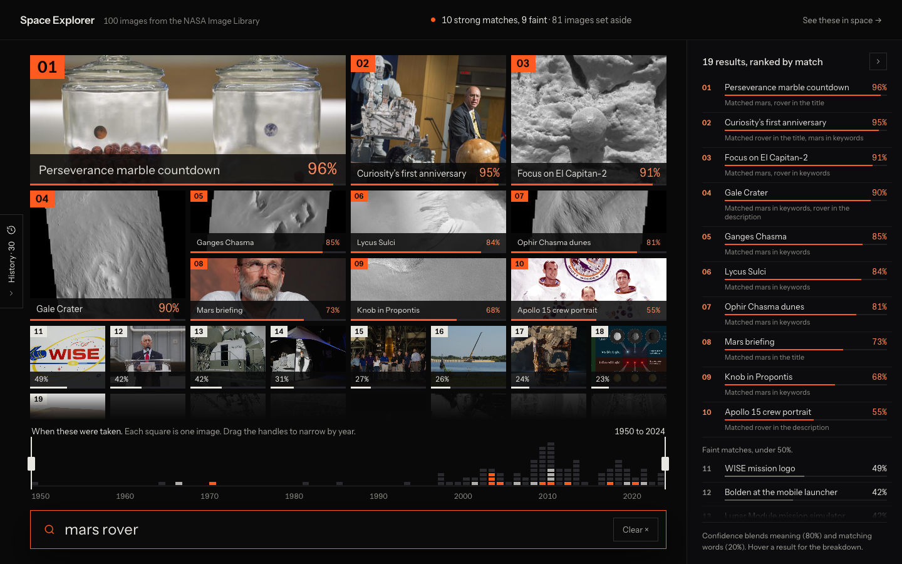
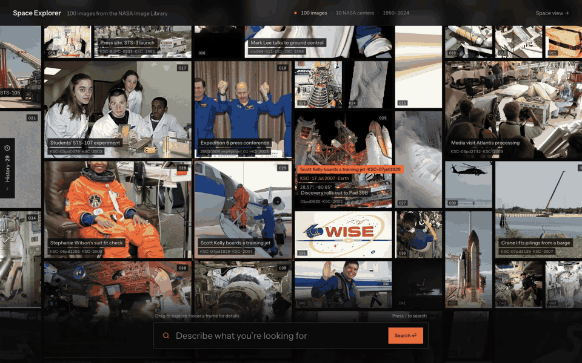

# Space Explorer

Browse and search 100 NASA images in plain English. Each result has a confidence score.
Search is hybrid: Postgres full-text search for exact words, plus a small local text-embedding model for meaning.
Every search is saved with its results, and a 3D "Where in space" view shows where each photo was taken.



**Live demo:** https://homework.nightcoding.dev <!-- TODO: confirm the demo is live before sharing -->

## Quick start

You need Docker with Docker Compose.

```bash
docker compose up --build
```

Then open http://localhost:3001.

- The first build takes a few minutes. It downloads the embedding model (about 90 MB) into the backend image.
- The backend API is on http://localhost:5001, and its docs are at http://localhost:5001/docs.
- Postgres is on port 5433. The seed runs on every start and never deletes data, so the search history survives restarts.

For development with hot reload (Vite dev server and uvicorn `--reload`):

```bash
docker compose -f docker-compose.dev.yml up --build
```

After a schema change, the old database volume needs a reset once: `docker compose down -v`.

## Features

| Requirement | How it works |
|---|---|
| 1. Browse images | The whole archive on one dark canvas: all 100 photos at once, oldest first, each with a plate number. The canvas drifts slowly, and you can drag it. Click a photo for the details: the full image, the NASA description, date, center, keywords, photographer, location, and where in space it was taken. The details open with `?image=<id>`, so they can be linked, and Back closes them. ←/→ move to the previous or next image. |
| 2. Natural-language search | Hybrid search: full-text (exact words, IDs like "STS-135") plus vector search (meaning: "animals" finds the manatees and the heron). Each result has a confidence score, with a breakdown of meaning and words, and a "why it matched" line. The canvas reflows by rank: rank 1 is the biggest frame, and images that did not match are set aside in grey. Results at 50% or more are "strong" (orange). |
| 3. Search history | Each search is stored with a snapshot of its results. The History drawer (left edge, `?history=1`) lists past searches, newest first, grouped by day, with "N images, K strong, best X%" and the top 3 thumbnails. Reopen a search and you see exactly what you saw. Delete one entry, with 6 seconds to undo. The list uses keyset (cursor) pagination, 10 at a time ("Show 10 older searches"). |
| 4. Special feature | "Where in space", a 3D map of where every photo was taken. See below. |

Bonus items:

- **Filtering:** on a results page, a year timeline with two handles narrows the results by year
  (`?from=&to=`). The scene filters by year too. The history drawer can find a past search by text.
  The sources API also filters by NASA center and place (`/api/sources?center=&body=`).
- **Pagination:** keyset pages for history, offset pages in the sources API.
- **Fallback:** if the model cannot load, search continues keyword-only.
- **Keyboard:** `/` focuses search, Enter runs it, ↑/↓ step through results, ←/→ in the details, Esc closes the top layer.

Coming soon: short display titles, hand-curated like the places, and an image credit field.

## Special feature

### Feature name

**Where in space**: a 3D line-art map that puts every image where it was taken. The places are
Earth (launch pads, NASA centers, Star City, Baikonur), Earth orbit (the ISS and Shuttle orbits),
Mars (at the coordinates from the caption) and deep space (Saturn, the asteroid belt).

### Why this feature

- The images have a lot of place information, but it is hidden in captions and metadata: Mars
  coordinates, launch pads, "taken from the ISS".
- A map answers questions a grid cannot: "What was photographed on Mars?", "How much of this
  archive is Kennedy Space Center?", "Which photos were taken in orbit?"
- It also connects to search. On a results page, "See these in space →" opens the scene
  (`/scene?search=<id>`): the strong results light up orange, the faint ones white, and the rest are
  dimmed. You see *where* your results are. From the image details, "Fly there in Space view →"
  flies to that one photo.
- Conntour's product searches camera footage. "Where and when was this seen" is the same kind of
  question, in a different domain.

### Implementation details

- **Places are data, not guesses.** `backend/scripts/build_places.py` drafts a place for each
  image from rules: Mars coordinates in the caption, ISS and Shuttle photo-ID patterns, the
  location field, and named sites. Then I reviewed all 100 by hand against the captions. 27
  entries changed. The result is `backend/data/places.json`, and tests check it.
- **Honest provenance.** Each place says how we know it: from the caption, from the location
  field, set by hand, or "approx.: NASA center". The card shows this, so an approximate pin never
  looks exact.
- **Fast rendering.** It is built with react-three-fiber. All pins are one `THREE.Points` cloud, and
  each body's line art (coastlines, grids, orbit rings) is one `LineSegments`. The canvas draws
  only when something changes (`frameloop="demand"`).
- **Sharp labels.** The labels are HTML over the canvas, projected from 3D every frame, with no
  React re-render per frame. The labels, the click picking and the drawing use the same projection,
  so they always agree.
- **Clusters.** Nearby pins (within 2.5°) become one cluster marker with a count. Kennedy Space
  Center alone has about 40 photos. A click fans the cluster out on a sunflower spiral, with thin
  lines back to the true spots.
- **Camera flights** between levels and pins. The camera swings around a planet, not through it.
  Reduced motion is respected.
- **Not to scale on purpose.** Planet sizes keep their real ratio, and the orbit rings keep their
  real inclinations (ISS 51.6°, Shuttle 28.5°). The distances are shortened, otherwise Mars would
  be a dot.
- **Year rail.** One square per image, one row per year (1950–2024). Drag to filter.
- **Lazy-loaded.** The scene is its own chunk (three.js). The rest of the app never downloads it.
- **Challenges:** orbit photos have no ground position, so they are spaced along their ring and
  drift slowly. 40 photos at one site needed clusters. Labels on the far side of a planet must hide.

More detail: [docs/ARCHITECTURE.md, section 9](docs/ARCHITECTURE.md#9-the-scene-where-in-space).

### Demo



Open it at http://localhost:3001/scene (or "Space view →" in the header). Try
`/scene?focus=<image id>` to fly to one image, or `/scene?search=<search id>` to open a stored search on the level with most strong matches.

## Search quality

The search was measured, not guessed. `backend/scripts/eval_search.py` has 14 queries with
hand-labeled relevant images and 3 off-topic queries.

| Mode | P@5 | Recall |
|---|---|---|
| Keyword only | 0.57 | 0.65 |
| Meaning only | 0.64 | 0.96 |
| **Hybrid (used)** | **0.82** | **0.96** |

- Confidence = 80% meaning + 20% matching words. Five formulas and nine embedding models were
  compared. all-MiniLM-L6-v2 won.
- Known limit: "red planet" finds the Mars images in the right order, but only as faint matches.

Details: [docs/search-eval.md](docs/search-eval.md).

## Tests

```bash
# Backend: 58 tests. Needs the compose db on port 5433 (uses a separate test database).
cd backend && uv run pytest

# Frontend: 111 unit tests for the pure helpers (matching, titles, timeline, history, scene math).
cd frontend && npm install && npx vitest run

# Search quality table (inside the running backend container, which has the model).
docker compose exec backend python scripts/eval_search.py
docker compose exec backend python scripts/eval_search.py --tune
```

## Project structure

```
backend/
  app.py              app setup; lifespan creates the schema and loads the model once
  config.py           settings and all search constants
  models.py           Pydantic API schemas
  controllers/        HTTP routes: sources, searches, places, health
  services/           search use case, scoring, embedding, history cursors
  repositories/       all SQL: sources, hybrid retrieval, history
  db/                 SQLAlchemy models, session, schema setup
  scripts/            seed_db.py, eval_search.py, build_places.py
  data/               mock_data.json (100 NASA items), places.json (reviewed places)
  tests/              pytest
frontend/
  src/api/            typed fetch client and API types
  src/hooks/          React Query hooks (the only code that calls the API) and URL state
  src/lib/            pure helpers with tests
  src/pages/          BrowsePage (archive canvas), SearchResultsPage, ScenePage
  src/components/     UI: canvas frames, search dock, rank rail, timeline, modal, history drawer
  src/scene/          the 3D "Where in space" view
  nginx.conf          serves the build, proxies /api
deploy/
  worker/             Cloudflare Worker (HTTPS, rate limit) for the live demo
docs/                 architecture, Q&A, search eval, design handoff, plan
docker-compose.yml        local stack (frontend on 3001)
docker-compose.dev.yml    hot reload
docker-compose.prod.yml   production stack (port 80, password from .env)
```

## Deploy

One VM runs `docker-compose.prod.yml`, and a Cloudflare Worker gives HTTPS and a rate limit on
`homework.nightcoding.dev`. Runbook: [deploy/README.md](deploy/README.md).

## Further docs

- [docs/ARCHITECTURE.md](docs/ARCHITECTURE.md): diagrams, data model, search, history, scene, decisions, scale.
- [docs/QA.md](docs/QA.md): short answers to likely questions.
- [docs/search-eval.md](docs/search-eval.md): how the search was measured and tuned.
- [docs/PLAN.md](docs/PLAN.md): the original plan (some parts changed; the code is the source of truth).
- [docs/design-handoff/HANDOFF.md](docs/design-handoff/HANDOFF.md): the visual design spec.

## The assignment

The original task from Conntour, in short:

1. **Browse images** from the `/sources` API, with a clear, friendly view and image metadata.
2. **Search using natural language** (for example "images of Mars rovers", "solar flares"), with a
   **confidence score** per result.
3. **Search history**: keep past searches and their results, revisit them, **delete individual
   searches**, and **support pagination** (or another way to handle large result sets).
4. **Special feature**: one creative feature that shows full-stack skills, documented in the README
   with: feature name, why this feature, implementation details, demo.

Notes from the assignment: real ML or NLP is not required. Bonus points for filtering, pagination
or authentication. The given stack is FastAPI + async SQLAlchemy + PostgreSQL, React + TypeScript +
Tailwind, Docker Compose, nginx and uv.
