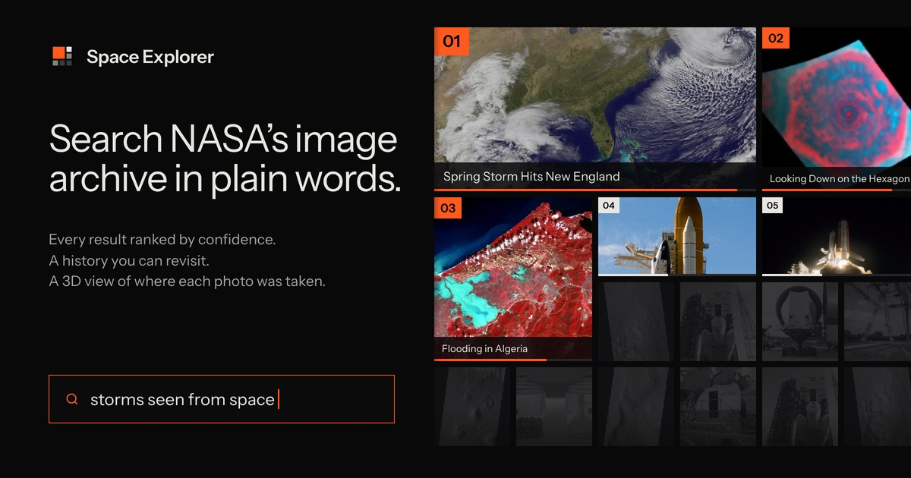
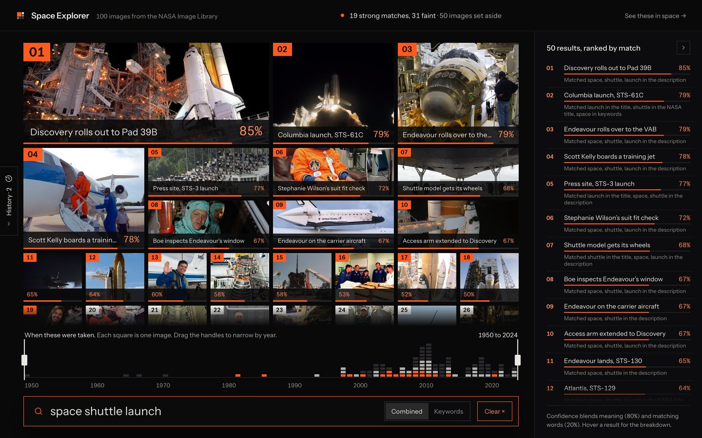
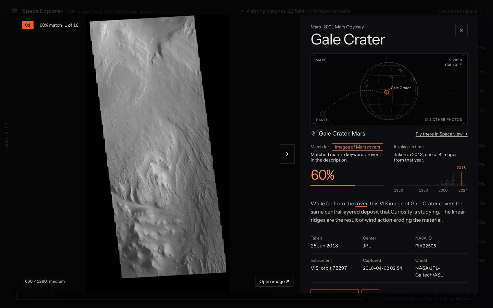
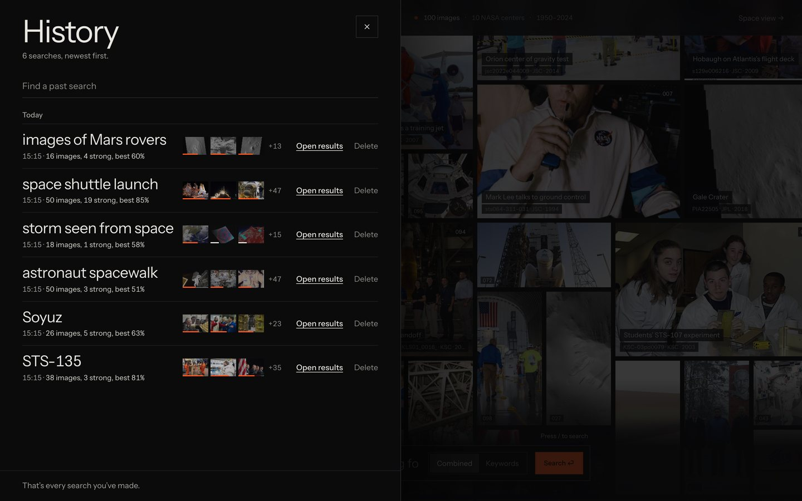
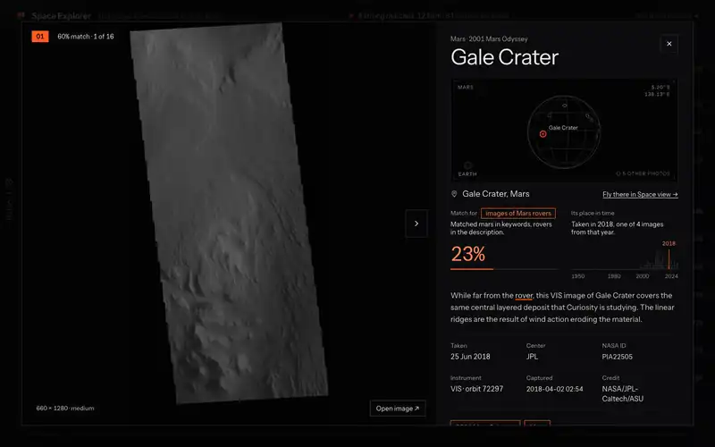
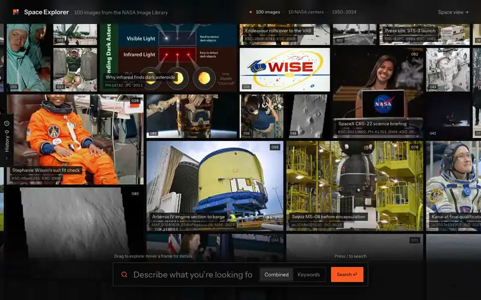

<p align="center">
  
</p>

<p align="center">
  <b>Search NASA's image archive in plain words.</b><br />
  Every result ranked by confidence, a history you can revisit, and a 3D view of where each photo was taken.
</p>

<p align="center">
  <a href="https://homework.nightcoding.dev"><b>Live demo</b></a> ·
  <a href="docs/ARCHITECTURE.md">Architecture</a> ·
  <a href="docs/search-eval.md">Search eval</a> ·
  <a href="docs/QA.md">Q&amp;A</a>
</p>



A full-stack take on the [Conntour home assignment](#the-assignment): browse 100 NASA images, search
them in natural language with a confidence score, keep a search history, and one special feature.
FastAPI + PostgreSQL (pgvector) + React, in Docker Compose.

## Contents

- [Quick start](#quick-start)
- [What it does](#what-it-does)
- [Special features](#special-features): Where in space · Meaning search with a small local model · A living archive
- [Infra highlights](#infra-highlights)
- [Tests](#tests) · [Project structure](#project-structure) · [Deploy](#deploy) · [Docs](#docs)

## Quick start

You need Docker with Docker Compose.

```bash
docker compose up --build
```

Open http://localhost:3001.

- The first build takes a few minutes: it bakes the embedding model (about 90 MB) into the backend image.
- API on http://localhost:5001, interactive docs at http://localhost:5001/docs. Postgres on port 5433.
- The seed runs on every start and only fills what is missing, so the search history survives restarts.
- Hot reload (Vite + `uvicorn --reload`): `docker compose -f docker-compose.dev.yml up --build`.

## What it does

| Requirement | How it works |
|---|---|
| **1. Browse images** | All 100 photos on one canvas that fills the window and scrolls upward on its own. Click a photo for the details: the full image, NASA's caption, date, center, keywords, photographer, credit, and where in space it was taken. The details live in the URL (`?image=<id>`), so they can be linked, and Back or Esc closes them. ←/→ step through. |
| **2. Natural-language search** | Hybrid search: Postgres full-text for exact words and IDs ("STS-135") plus vector search for meaning ("animals" finds the heron and the manatees, though no caption says "animals"). Every result has a **confidence score**, a meaning/words breakdown and a "why it matched" line. The canvas reflows by rank: rank 1 is the biggest frame, strong matches (50%+) are orange, and the rest are set aside in grey. A **Combined / Keywords** toggle runs the same words both ways. |
| **3. Search history** | Every search is saved with a snapshot of its results, so reopening one shows exactly what you saw. The drawer groups searches by day with "N images, K strong, best X%" and the top 3 thumbnails, finds a past search by text, **deletes** one with 6 seconds to undo, and **paginates** with a keyset cursor (10 at a time). |
| **4. Special feature** | "Where in space": a 3D line-art map of where every photo was taken. [Below](#1-where-in-space). |

**Bonus:** filtering (a year timeline with two handles, `?from=&to=`; the scene filters by year too),
pagination (keyset for history, offset for sources), a keyword-only fallback if the model cannot load,
and keyboard control (`/` focuses search, ↑/↓ through results, ←/→ in the details, Esc closes).

<table>
  <tr>
    <td width="50%"></td>
    <td width="50%"></td>
  </tr>
  <tr>
    <td>Results: size says rank, orange says strong, the timeline says when.</td>
    <td>Details: the match explained, where and when it was taken.</td>
  </tr>
  <tr>
    <td colspan="2"></td>
  </tr>
  <tr>
    <td colspan="2">History: every search with its snapshot, grouped by day, found by text, deleted with undo.</td>
  </tr>
</table>

## Special features

### 1. Where in space

> The special feature the assignment asks for.

#### Feature name

**Where in space**: a 3D line-art map that puts every image where it was taken: on Earth (launch
pads, NASA centers, Star City, Baikonur), in Earth orbit (the ISS and Shuttle orbits), on Mars (at
the coordinates in the caption) and in deep space (Saturn, the asteroid belt).

#### Why this feature

- The archive is full of place information, hidden in captions and metadata: Mars coordinates,
  launch pads, "taken from the ISS". A map answers what a grid cannot: what was photographed on
  Mars, how much of the archive is Kennedy, which photos were taken in orbit.
- It connects to search. "See these in space →" opens your results on the map: strong matches
  orange, faint ones white, the rest dimmed. "Fly there in Space view →" in the details flies to
  one photo.
- Conntour searches camera footage. "Where and when was this seen" is the same question in a
  different domain.

#### Implementation details

- **Places are data, not guesses.** `backend/scripts/build_places.py` drafts a place per image from
  rules (Mars lat/lon in the caption, ISS and Shuttle photo-ID patterns, the location field, named
  sites). I reviewed all 100 by hand against the captions; 27 changed. The result,
  `backend/data/places.json`, is seeded and tested.
- **Honest provenance.** Each place says how we know it: from the caption (58), the location field
  (30), set by hand (8), or approximately the NASA center (4). The UI says it in words.
- **A handful of draw calls.** react-three-fiber. All pins are one `THREE.Points` cloud; each body's
  line art (coastlines, graticule, orbit rings) is one `LineSegments`. It renders on demand only.
- **Sharp labels.** HTML labels over the canvas, placed by projecting 3D anchors every frame without
  a React render. Labels, click picking and pins share one projection, so they always agree.
- **Clusters.** Pins within 2.5° merge into a count. Kennedy alone has about 40 photos; a click fans
  them out on a sunflower spiral with leader lines to the true spots.
- **Not to scale, on purpose.** Planet size ratios and orbit inclinations (ISS 51.6°, Shuttle 28.5°)
  are real; distances are shortened, or Mars would be a dot.
- **A detailed locator in the details** (an orthographic SVG globe with real coastlines, rotated to
  the place, animated in on open), so the place is visible before you open the 3D view.
- **Lazy-loaded.** three.js is its own chunk (230 kB gzip). The archive, results and history never
  download it. No WebGL: a fallback message, and the rest of the app works.

#### Demo



Open http://localhost:3001/scene, or try `/scene?focus=<image id>` (fly to one photo) and
`/scene?search=<search id>` (a stored search, on the level with the most strong matches).

### 2. Meaning search with a small local model

Real ML was not required. I added a small local model anyway, because "animals" should find the
manatees even though no caption says "animals".

- **One SQL round trip.** Full-text (a weighted generated `tsvector` with a GIN index) and vectors
  (pgvector, HNSW) run in one query and merge their candidates. A row found by one side still gets
  the other side's score. No separate search service.
- **A tiny model, in process.** `all-MiniLM-L6-v2` through fastembed (ONNX, no PyTorch): 87 MB,
  about 0.7 ms per query on CPU, run in a threadpool so the event loop never blocks. Nine models
  were compared; this one had the best top-5.
- **One number.** Confidence = 80% meaning + 20% matching words, with two guard rules: gibberish
  ("zzqx") returns nothing, and an ID in the query ("STS-135") decides which results can be strong.
- **Measured, not guessed.** `backend/scripts/eval_search.py` scores 15 hand-labeled queries plus
  off-topic and gibberish ones:

  | Mode | Top-5 precision | Recall |
  |---|---|---|
  | Keywords only | 0.62 | 0.82 |
  | Meaning only | 0.75 | 0.97 |
  | **Hybrid (used)** | **0.83** | **0.97** |

  The eval also checks the orange label: 55% of strong results are relevant. It was 30% until one
  constant changed (the meaning score saturated too early); top-5 and recall stayed the same.
  Details in [docs/search-eval.md](docs/search-eval.md).
- **Known limits.** It reads captions, not pixels: "rocket launch" ranks press events that mention
  rockets above actual launch photos, and "mars rover" still marks some orbital Mars photos strong.
  No typo tolerance. Next steps: an image model (CLIP) as a third signal, a re-ranker on the top 20,
  and `pg_trgm` to correct typos.

### 3. A living archive: endless canvas, search reflow, timeline



- **An endless canvas.** The archive scrolls upward forever. Each round is all 100 photos in a new
  order, packed into a full rectangle so rounds stack with a straight seam; rounds that leave the
  top are dropped (2–3 in the DOM). One `requestAnimationFrame` loop writes the transform directly,
  eases to a stop while you hover a photo, and is off under reduced motion.
- **Search as a reflow.** View Transitions: each photo has the same `view-transition-name` on both
  pages, so the matches glide from the canvas into their ranked places, rank 1 first, and the rest
  fade aside. Bars fill and percentages count up. No animation library.
- **The timeline.** One square per image, one column per year (1950–2024). Results light up
  strongest first; drag the handles to filter by year, and the URL keeps it.

## Infra highlights

- **Our servers never touch an image file.** The database stores URLs; the browser loads the photos
  from NASA.
- **One POST does everything:** embed, retrieve, score, store the snapshot, read it back. The
  results page renders from the cache with no second request.
- **Layered backend:** controllers (HTTP) → services (logic, pure scoring) → repositories (all SQL)
  → db. Repositories return Pydantic models, never ORM rows, so async lazy-loading cannot bite.
- **Snapshots and keyset pages.** Reopening a search is a primary-key read; history pages cost the
  same at any depth, and a delete never shifts the next page. Row stats come from one LATERAL query
  per page (no N+1).
- **Startup cannot fail on a download.** The model is baked into the image at build time and
  `HF_HUB_OFFLINE=1` is set. If it still cannot load, search falls back to keywords and
  `/api/health` reports `degraded` but stays up.
- **Safe on every start.** An idempotent seed and schema (`create_all` plus `ADD COLUMN IF NOT
  EXISTS`); `uv sync --frozen` from `uv.lock` for reproducible builds.
- **Frontend:** server state in React Query, everything else in the URL (every view can be linked,
  survives a reload, and Back works). Only one file calls `fetch`. Main bundle 93 kB gzip.
- **Three compose files:** local, hot-reload dev, and production with no host ports for the db or the
  backend.
- **Production edge:** a Cloudflare Worker gives HTTPS and limits writes to 10 per minute per IP. It
  sends a shared secret, and nginx on the VM answers 403 without it, so nobody can skip the limit.
  nginx adds long-cache hashed assets and security headers.

## Tests

```bash
# Backend: 84 tests, API tests through httpx on a real Postgres (a separate test database)
# with a fake embedder, plus pure tests for scoring, cursors, places and titles.
cd backend && uv run pytest

# Frontend: 142 unit tests for the pure helpers (matching, titles, canvas packing, timeline, scene math).
cd frontend && npm install && npx vitest run

# Search quality (inside the running backend container, which has the model).
docker compose exec backend python scripts/eval_search.py
```

## Project structure

```
backend/
  app.py              app setup; lifespan creates the schema and loads the model once
  config.py           settings and all search constants
  controllers/        HTTP routes: sources, searches, places, health
  services/           search use case, scoring, embedding, history cursors
  repositories/       all SQL: sources, hybrid retrieval, history
  db/                 SQLAlchemy models, session, schema setup
  scripts/            seed_db.py, eval_search.py, build_places.py
  data/               mock_data.json (100 NASA items), places.json, titles.json
  tests/              pytest
frontend/
  src/api/            typed fetch client and API types
  src/hooks/          React Query hooks (the only code that calls the API) and URL state
  src/lib/            pure helpers, with tests
  src/pages/          archive canvas, search results, scene
  src/components/     canvas, search dock, rank rail, timeline, modal, history drawer
  src/scene/          the 3D "Where in space" view
deploy/               Cloudflare Worker and the nginx origin guard
docs/                 architecture, Q&A, search eval, demo script, design handoff
```

## Deploy

One VM runs `docker-compose.prod.yml`; a Cloudflare Worker on `homework.nightcoding.dev` gives HTTPS
and the rate limit. Runbook: [deploy/README.md](deploy/README.md).

## Docs

- [docs/ARCHITECTURE.md](docs/ARCHITECTURE.md): diagrams, data model, search, history, scene, decisions, scale.
- [docs/search-eval.md](docs/search-eval.md): how the search was measured and tuned.
- [docs/QA.md](docs/QA.md): short answers to likely questions.
- [docs/DEMO.md](docs/DEMO.md): the presentation script.
- [docs/design-handoff/HANDOFF.md](docs/design-handoff/HANDOFF.md): the visual design spec.

## The assignment

The task from Conntour, in short:

1. **Browse images** from the `/sources` API, with a clear, friendly view and image metadata.
2. **Search using natural language** (for example "images of Mars rovers", "solar flares"), with a
   **confidence score** per result.
3. **Search history**: keep past searches and their results, revisit them, **delete individual
   searches**, and **support pagination**.
4. **Special feature**: one creative feature that shows full-stack skills, documented with its name,
   why, implementation details and a demo.

Real ML or NLP was not required. Bonus points for filtering, pagination or authentication. The given
stack: FastAPI, async SQLAlchemy, PostgreSQL, React, TypeScript, Tailwind, Docker Compose, nginx, uv.

Images: [NASA Image and Video Library](https://images.nasa.gov).
