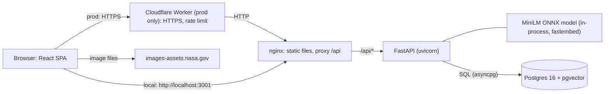
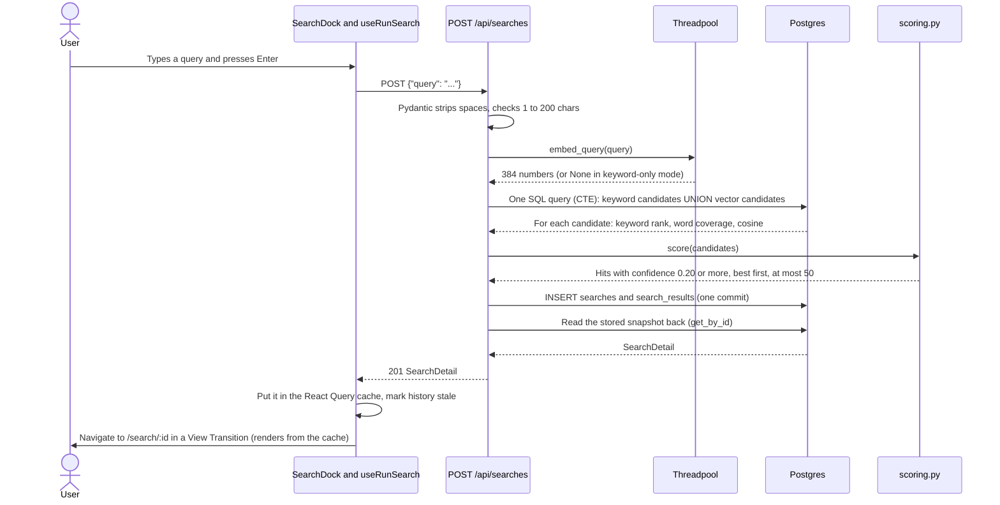
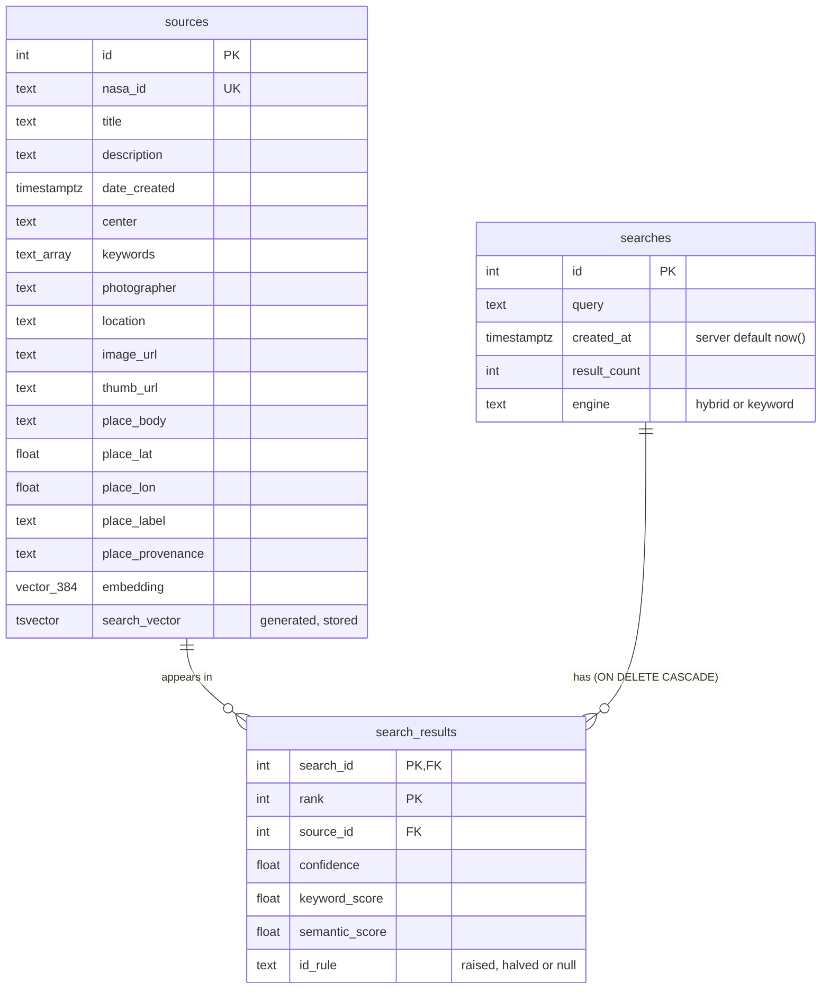

# Architecture

This page explains how Space Explorer works, part by part. Every claim here points to the code.
For short interview answers, see [QA.md](QA.md).

## 1. Overview

Space Explorer is a small web app over 100 NASA images. The browser runs a React single-page
app. nginx serves the static files and forwards `/api/*` to a FastAPI backend. The backend
keeps the images, the search history and a vector for each image in one Postgres database
with the pgvector extension. A small text-embedding model (all-MiniLM-L6-v2, ONNX, about
90 MB) runs inside the backend process, so search needs no external service. In production,
a Cloudflare Worker gives HTTPS on `homework.nightcoding.dev` and forwards every request to
the VM that runs the same Docker Compose stack.



The image files themselves never pass through our servers. The database stores only the
URLs (`image_url`, `thumb_url`), and the browser loads them from NASA.

## 2. One search, step by step



The code path:

1. `frontend/src/components/SearchDock.tsx` runs the search on submit only, not on each key.
   Every run is a history entry, so typing "m", "ma", "mar" must not create three entries. For the
   same reason a ref blocks a second submit while one is in flight, and a held Enter is ignored.
2. `useRunSearch` in `frontend/src/hooks/searches.ts` calls `api.runSearch`.
3. `backend/controllers/searches.py` (`create_search`) validates the body with
   `SearchRequest` in `backend/models.py`.
4. `backend/services/search.py` (`score_query`) embeds the query with `run_in_threadpool`.
   ONNX inference is synchronous CPU work. On the event loop it would block every other request.
5. `backend/repositories/search.py` (`HYBRID_CANDIDATES_SQL`) gets both raw scores in one round trip.
6. `backend/services/scoring.py` (`score`) turns the raw scores into one confidence.
7. `backend/repositories/history.py` (`create`) stores the search and its results in one transaction.
8. `run_search` reads the snapshot back through `get_by_id`, the same path as
   `GET /api/searches/{id}`. So a fresh search and a reopened one always look the same.
   `test_reopened_search_is_the_stored_snapshot` in `backend/tests/test_api.py` checks this.
9. `useRunSearch.onSuccess` puts the response in the cache under `["search", id]`, invalidates
   `["history"]`, and navigates to `/search/{id}`. The results page makes no second request. The
   navigation runs inside a View Transition (`frontend/src/lib/viewTransition.ts`), so each photo
   glides from its place on the archive canvas to its place in the ranked results.

## 3. Data model



The models are in `backend/db/models.py`. `sources` also has `image_width` and `image_height`.

Key choices:

- **Place columns are flat** on `sources`, not a separate table. Each image has exactly one place.
- **`search_vector` is a generated column.** Postgres keeps it up to date. The title has weight A,
  the keywords B, the description C, so a word in the title ranks higher than the same word in
  the long caption. A generated column needs an IMMUTABLE expression, and `array_to_string` is
  only STABLE. So `backend/db/schema.py` creates a small `immutable_array_to_string` wrapper.
- **`embedding` is NULL** until the seed embeds the row. Search then treats that row as keyword-only.
- **`search_results` is a snapshot.** It stores the rank, the three scores and `id_rule` as the user
  saw them. `id_rule` came later, so `backend/db/schema.py` adds it with
  `ALTER TABLE ... ADD COLUMN IF NOT EXISTS` (old rows keep NULL), like `short_title` and `credit`.
  The primary key is `(search_id, rank)`.

Indexes and why each one exists:

| Index | Columns | Why |
|---|---|---|
| `ix_sources_search_vector` | GIN on `search_vector` | Finds rows that contain the query words (`@@`) without a full scan. |
| `ix_sources_embedding_hnsw` | HNSW on `embedding`, `vector_cosine_ops` | Nearest neighbours by cosine distance (`<=>`). At 100 rows the planner does a scan, which is cheaper. The index is there for large tables. |
| `ix_sources_date_created_id` | `date_created DESC, id` | Matches the Browse `ORDER BY` exactly, so a page is an index range scan. |
| `ix_searches_created_at_id` | `created_at DESC, id DESC` | Matches the history `ORDER BY` and the keyset row comparison. |
| `search_results_pkey` | `(search_id, rank)` | Loads one search's results in rank order. Also serves the history stats and previews (`rank <= 3`). |
| `sources_nasa_id_key` | unique `nasa_id` | The seed and `places.json` join on `nasa_id`. |

## 4. Backend layers

The scaffold had `controllers → repositories → db`. I kept that and added a `services/` layer
for the logic that is not HTTP and not SQL.

| Folder / file | Job |
|---|---|
| `backend/app.py` | Creates the app, registers the routers. The lifespan creates the schema and loads the model once (`app.state.embedder`). |
| `backend/config.py` | Environment settings (database URL, model name) and all search constants in one place. |
| `backend/models.py` | Pydantic schemas: the JSON contract with the frontend (snake_case). |
| `backend/controllers/` | HTTP only: routes, query parameters, status codes, 404s. `dependencies.py` gives the embedder to routes, so tests can swap it. |
| `backend/services/` | Logic. `search.py` (the search use case), `scoring.py` (pure scoring functions), `embedding.py` (the `Embedder` protocol, the real model and the keyword-only fallback), `cursor.py` (opaque history cursors). |
| `backend/repositories/` | All SQL. They return Pydantic models, never ORM rows. `source.py` (browse, one image, places), `search.py` (the hybrid retrieval query), `history.py` (create, page, get, delete). `base.py` is the scaffold's generic `Repository[T]`. |
| `backend/db/` | SQLAlchemy models, the async engine and session, and `schema.py` (idempotent schema setup). |
| `backend/scripts/` | `seed_db.py` (idempotent seed, runs on every start), `eval_search.py` (search quality), `build_places.py` (one-off draft of the places). |
| `backend/data/` | `mock_data.json` (the 100 NASA items) and `places.json` (a hand-reviewed place for each image). |
| `backend/tests/` | pytest: API tests on a separate database, plus pure tests for scoring, cursors and places. |

API endpoints:

| Method and path | Returns |
|---|---|
| `GET /api/sources?limit=24&offset=0&center=&body=` | `{items, total}`, newest first, optional filters |
| `GET /api/sources/{id}` | One image with full metadata and its place |
| `POST /api/searches` `{query}` | 201 and the stored `SearchDetail` |
| `GET /api/searches?limit=20&cursor=` | `{items, next_cursor, total}`, newest first |
| `GET /api/searches/{id}` | The stored snapshot (not a re-run) |
| `DELETE /api/searches/{id}` | 204, or 404 |
| `GET /api/places` | One light row per image for the 3D scene (no captions) |
| `GET /api/health` | `{status, db, embedder}`. 503 only when the database is down |

The seed (`backend/scripts/seed_db.py`): the original scaffold dropped all tables on every
start. With a history table, every restart would erase the history. Now each step only fills
what is missing: create the schema if needed, insert the sources only when the table is empty,
embed rows whose embedding is NULL, and apply `places.json` (cheap, and it picks up hand edits).

## 5. How search and confidence work

Search is **hybrid**: full-text search finds exact words, and vector search finds meaning.

- Full-text search is good at names and IDs like "STS-135" or "Soyuz". It cannot find "red planet"
  or "animals", because no caption contains those words.
- Vector search finds those by meaning, but its top 5 is noisier and it returns more off-topic results.

**Retrieval (one SQL query, `backend/repositories/search.py`).**

1. CTE `q`: the query as an OR of its stemmed words. `plainto_tsquery` ANDs the words, so
   "images of Mars rovers" would need every word. The code replaces `&` with `|`. It also keeps
   the stemmed words as an array, to count how many of them each row contains.
2. CTE `candidates`: the best rows by keyword rank (GIN) UNION the nearest rows by cosine
   distance (HNSW at scale), up to `CANDIDATE_POOL = 200` from each side. In keyword-only mode
   the query vector is NULL, and the vector branch turns itself off.
3. For every candidate: `ts_rank_cd(search_vector, q, 32)`, how many query words it contains,
   and the cosine `1 - (embedding <=> qvec)`. A row that only one side found still gets both scores.

**Scoring (Python, `backend/services/scoring.py`).** In one sentence: *confidence is 80% how
close the meaning is and 20% how many of your words the image's text contains.*

```
meaning    = clamp((cosine - 0.20) / (0.50 - 0.20), 0, 1)
words      = ts_rank_cd(..., 32) * (query words found / query words)
confidence = 0.8 * meaning + 0.2 * words
```

- `ts_rank_cd` with normalization 32 is `rank / (rank + 1)`, so it is already between 0 and 1.
- The coverage factor exists because the OR query lets one word match. "solar flares" would
  otherwise give full word credit to "Parker Solar Probe". With coverage it gets half.
- Raw cosine is not a usable confidence. Unrelated captions still score about 0.2, and the best
  matches here rarely pass 0.5. So the code stretches the band 0.20–0.50 to 0–1.
- In keyword-only mode (no model), confidence = words.

The constants (all in `backend/config.py`):

| Constant | Value | Meaning |
|---|---|---|
| `SEMANTIC_FLOOR` | 0.20 | Cosine at or below this counts as "unrelated" (0) |
| `SEMANTIC_CEIL` | 0.50 | Cosine at or above this counts as "clearly about it" (1) |
| `SEMANTIC_WEIGHT` / `KEYWORD_WEIGHT` | 0.8 / 0.2 | The blend |
| `MIN_CONFIDENCE` | 0.20 | Results below this are dropped |
| `STRONG_MATCH` | 0.5 | At or above this a result is "strong" (orange in the UI) |
| `MAX_RESULTS` | 50 | At most 50 results per search |
| `CANDIDATE_POOL` | 200 | Rows each retriever may give before scoring |
| `MAX_QUERY_LENGTH` | 200 | Longer queries get 422 |
| `ID_MISMATCH_FACTOR` | 0.5 | The ID rule: a result without the queried ID gets half its score |

**Two guard rules** come after the formula (`score` in `backend/services/scoring.py`; the
measurements are in [search-eval.md](search-eval.md), "Choice 3"):

1. **Gibberish.** If the model knows none of the query's words ("zzqx"), only results that contain
   one of the words can appear.
2. **IDs.** If the query names an ID ("STS-135", "Expedition 61", "PIA22505"), images with that
   exact ID are raised to at least 0.5, and images without it get half their score, which is always
   under 0.5. `query_ids` finds the IDs: a word with a digit, or a bare number with the word before
   it. A year (1900–2099) is a date, not an ID ("launch in 2011"), unless a capitalized name comes
   before it ("SSME 2058").

The ID rule changes the confidence after the blend, so "Meaning 100% · Words 27%" no longer adds
up to the 43% on screen. So each hit carries `id_rule` (`"raised"`, `"halved"` or `null` when the
rule changed nothing). The history snapshot stores it, and the UI ends the breakdown and the
"why it matched" line with "halved: “STS-135” is not in this image" or "raised: it has “STS-135”"
(`idRuleNote` in `frontend/src/lib/format.ts`).

**Why 80/20.** `backend/scripts/eval_search.py` compared five formulas, each with its own tuned
constants. The first version was 50/50. With 50/50 a match on meaning alone could never score
above 0.5, so it could never be strong. Noisy-OR and `max()` lost the order for "STS-135": every
STS-* caption gets the full meaning score, so the words could not lift the real STS-135 photos
above the other missions. 80/20 had the best P@5 (0.82) and recall (0.96), kept exact hits first,
and is a one-sentence rule. (These are the formula-comparison numbers, before the guard rules.
With the rules, hybrid is 0.83 and 0.97.)

**Why calibration is in Python, not SQL.** The original plan did it in SQL. In Python the
formula is a set of pure functions with unit tests (`backend/tests/test_scoring.py`). The eval
script gets the candidates once per query and then re-scores thousands of constant sets in
memory (`--tune`). The cost is small: at most 400 candidate rows per query.

**Why MiniLM and not bge-small.** The plan said bge-small-en-v1.5. The model sweep in
[search-eval.md](search-eval.md) measured nine models (before the guard rules). all-MiniLM-L6-v2 had the best P@5 (0.82)
and is one of the smallest and fastest (0.7 ms per query on a laptop CPU).

**The known limit.** MiniLM gives "red planet" → Lycus Sulci (Mars) the same cosine (0.359) as
"solar flares" → Parker Solar Probe (a Sun mission). Any calibration that makes the Mars images
strong also makes Parker strong. So "red planet" shows only faint matches (best 0.42), and the
order is not clean: ranks 1, 2, 5 and 7 are Mars images, but ranks 3 and 4 are an infrared
asteroid chart and the WISE mission logo.

Full numbers, the formula comparison and the model sweep: [search-eval.md](search-eval.md).

## 6. Search history

- **Snapshot.** Each search stores its results (`search_results`). Reopening a search reads the
  snapshot. It never re-runs the query, so history shows what the user saw, even after the model,
  the constants or the data change.
- **Keyset pagination.** `HistoryRepository.get_page` orders by `(created_at DESC, id DESC)` and
  continues with a row comparison `(created_at, id) < (last_created_at, last_id)`. A page costs
  the same however deep it is, and a delete never shifts later pages, so nothing is skipped or
  repeated. The `id` breaks ties when two searches have the same `created_at`. The query asks for
  `limit + 1` rows to know if a next page exists.
- **Opaque cursor.** `backend/services/cursor.py` encodes `(created_at, id)` as base64 JSON. The
  client only passes it back, so the format can change without breaking the API. A bad cursor
  gives 400. A naive datetime or a non-integer id is rejected.
- **Summary stats.** Each row has `strong_count` and `best_confidence` from a LATERAL subquery
  (computed only for the rows on the page), and up to 3 preview thumbnails from one extra query
  for the whole page (no N+1).
- **Total.** `total` is a full `count(*)` on `searches`, for the "N searches" header. That is fine
  at this size. At millions of rows it would become an estimate or a cached counter.
- **Delete.** `DELETE /api/searches/{id}` is one statement. The results go with it
  (`ON DELETE CASCADE`). A second delete gives 404.
- **Delete with undo** (`frontend/src/components/UndoDelete.tsx`). A deleted search cannot be
  re-created, because its snapshot is gone. So the UI waits: the row hides at once, and the
  DELETE request goes out only after 6 seconds. Undo only cancels the timer, so there is nothing
  to restore on the server. A toast shows "Gone in N s". A second delete sends the first one at
  once (one toast at a time). If the tab closes during the 6 seconds, the DELETE goes out with
  `fetch(..., {keepalive: true})` on `pagehide`. If the deleted search is open behind the drawer,
  the page goes back to the archive.
- **Optimistic delete.** When the 6 seconds end, `useDeleteSearch` in
  `frontend/src/hooks/searches.ts` removes the row from the cached pages. On an error it puts the
  old pages back. On success it drops the cached snapshot. In all cases it then refetches the history.
- **The history drawer** (`frontend/src/components/HistoryDrawer.tsx`) opens with `?history=1` on
  any page, so the page behind it stays mounted. It loads 10 searches per page and has a
  "Show 10 older searches" button and "Showing N of M" (from `total`). Rows are grouped by the
  user's day ("Today", "Yesterday", then weekday or month). Each row shows the query, "N images,
  K strong, best X%", the top 3 thumbnails with confidence bars, "Open results" (or "Search again"
  for a search with no results) and "Delete". A "Find a past search" box filters the rows that are
  already loaded, in the browser.
- `backend/tests/test_api.py` (`test_history_keyset_pagination_and_delete`) creates 25 searches,
  pages through them 10 at a time, deletes one, and checks that the old cursor still continues
  exactly where it stopped.

History is global, because there is no auth. The next step is an `owner_id` on `searches`.

## 7. The places pipeline (data for the special feature)

Every image gets one place, anywhere in space: `earth`, `orbit`, `moon`, `mars` or `deep_space`.
Places are decided ahead of time and committed. Nothing is guessed at runtime.

1. **Rules draft.** `backend/scripts/build_places.py` drafts a place for each image, in this order:
   - Mars (JPL images with a "Mars" keyword): `Latitude/Longitude` from the caption. Mars captions
     use 0–360 east longitude; `east_to_signed` converts it to −180..180.
   - Deep space (JPL, keyword Saturn, Vesta or WISE): the target's name, no coordinates.
   - Orbit: `iss…` IDs, and Shuttle onboard-camera IDs (`S131-E-…`, `STS064-311-…`).
   - Earth: caption phrases for exact sites ("pad 39b", "turn basin"), then the `location`
     field mapped to coordinates, then generic caption phrases ("star city"), then the NASA
     center's coordinates as the last fallback.
2. **Hand review.** I checked all 100 entries against their captions and fixed them. 27 of the
   100 entries in `backend/data/places.json` differ from the rules draft. Example: a satellite photo
   of a storm belongs off the New England coast, not at Goddard, which published it.
3. **Provenance.** Each place says how we know it: `caption` (58), `location field` (30),
   `manual` (8), `NASA center (approx.)` (4). The UI shows it as plain words ("from the caption",
   "approx.: NASA center"), so an approximate pin is never shown as exact.
4. **Load.** The seed applies `places.json` by `nasa_id` on every start.
   `backend/tests/test_places.py` checks that every image has exactly one valid place, and checks
   a few tricky cases.

Today: 77 Earth, 15 orbit, 6 Mars, 2 deep space, 0 Moon.

## 8. Frontend architecture

Stack: Vite 8, React 18, TypeScript 5, Tailwind 3, TanStack Query 5, react-router 6. The visual
design ("Signal") is specified in `docs/design-handoff/HANDOFF.md`.

**Data layer.**

- `frontend/src/api/client.ts` is the only place that calls `fetch`. It turns FastAPI errors
  (`{detail}` or the 422 list) into one `ApiError` with a `status`.
- `frontend/src/api/types.ts` mirrors the Pydantic schemas in snake_case. There is no mapping layer.
- `frontend/src/hooks/` is the only place that uses the API. Components use these hooks, and
  React Query handles caching, loading and errors.

**React Query** (`frontend/src/main.tsx` and the hooks):

| Query key | Hook | Notes |
|---|---|---|
| `["sources", "all"]` | `useArchive` | All 100 images in one request (`limit=100`), sorted oldest first. `staleTime: Infinity`. The canvas, the set-aside frames, the timelines and the modal's prev/next all read this one list. |
| `["source", id]` | `useSource` | The image modal. `initialData` comes from the archive list, so the modal opens with no wait. |
| `["search", id]` | `useSearch` | `staleTime: Infinity`: a snapshot never changes. Seeded by `useRunSearch`. |
| `["history"]` | `useHistory` | Infinite query, keyset, 10 per page: `getNextPageParam` returns `next_cursor`. |
| `["places"]` | `usePlaces` | The scene. `staleTime: Infinity`. |

Defaults: `staleTime` 5 minutes, no refetch on window focus, one retry on network or server
errors, no retry on a 4xx (a 404 does not change on retry). The search mutation has a key
(`RUN_SEARCH_KEY`), so any component can see that a search is running (`useIsMutating`).

**Routes** (`frontend/src/App.tsx`): `/` the archive canvas, `/search/:id` the results, `/scene`
(lazy), and a not-found page. `/history` redirects to `/?history=1`. `Layout` wraps every route. It
mounts the header, the History edge tab, the one shared image modal, the history drawer and the
undo toast.

**The URL holds the state**, so every view can be linked, survives a reload, and Back works:

- `/search/:id`: a fresh search and a search from history use the same route.
- `?image=<id>` on any page opens the image modal (`frontend/src/hooks/useImageParam.ts`). If the
  modal was opened inside the app, closing it is the same as Back. If it was opened from a pasted
  link, closing it removes the parameter. Prev/next inside the modal use `replace`.
- `?history=1` on any page opens the history drawer (`frontend/src/hooks/useHistoryDrawer.ts`).
  The page behind it stays mounted. One overlay at a time: with both `?image=` and `?history=1` in
  the URL, `Layout.tsx` shows only the drawer.
- `?from=&to=` on a results page narrows the results to those years
  (`frontend/src/hooks/useResultView.ts`). The ranks keep their numbers. Changes use `replace`,
  so dragging a handle does not fill the Back button.
- `/scene?focus=<source_id>` opens a pin, and `/scene?search=<search_id>` lights a stored search.

**One view of a search.** `useResultView` combines the stored search, the archive and the year
range from the URL. It returns the visible results and the strong, faint and "set aside" counts.
The header, the results page and the image modal all call it, so they always show the same
numbers (React Query dedupes the requests).

**Lazy scene.** `ScenePage` loads with `React.lazy`, so three.js is in its own chunk. In the
current build the main bundle is 268 kB (85 kB gzip) and the scene chunk is 916 kB (254 kB gzip).
The archive, the results and the history never download the scene code.

**Pure helpers** in `frontend/src/lib/`, each with unit tests where there is logic:

| File | Job |
|---|---|
| `match.ts` | `STRONG_MATCH = 0.5` (mirrors the backend), frame size by rank, the "5 strong matches, 8 faint" summary, and the "why it matched" line ("Matched mars, rover in the title", or "Similar in meaning" for a pure meaning match) |
| `displayTitle.ts` | About a third of the NASA titles are raw IDs ("iss071e608493"). For those it builds a short title from the caption: strip the ID, date and dateline, take the first sentence or clause, cap at 60 characters. The real `nasa_id` stays in the details. |
| `timeline.ts` | The year timeline: one square per image, stacked by year, and `?from=&to=` parsing |
| `history.ts` | Day groups ("Today", "Yesterday", weekday, month) and the one-line row summary |
| `canvas.ts` | Archive frame sizes from a stable hash of the id, date order, plate numbers |
| `details.ts`, `format.ts`, `highlight.ts`, `ids.ts` | Metadata formatting, the score breakdown with the ID rule's note, query-word highlighting (display only; the backend does the real matching), URL id parsing |
| `viewTransition.ts` | Wraps a navigation in `document.startViewTransition` when the browser has it and the user does not ask for reduced motion |

Display titles: the backend sends `short_title` (hand-written, `backend/data/titles.json`) and
`credit` (the photographer, else NASA's secondary creator). `displayTitle.ts` falls back to the
caption only when an image has no short title.

**Tokens.** Colors are CSS variables in `frontend/src/index.css`, mapped to Tailwind names in
`frontend/tailwind.config.ts`. One accent color (orange) means only "strong match / active". The
scene reads the same variables (`frontend/src/scene/tokens.ts`), so a token change restyles the 3D
view too. The font is Instrument Sans, self-hosted.

**The screens.**

- **Archive** (`/`, `frontend/src/pages/BrowsePage.tsx`). All 100 photos on one dark canvas that is
  larger than the window and drifts slowly. You can drag it. Frame sizes come from a hash of the
  id, so the layout is the same on every load. The order is oldest first, and each frame has a
  plate number (001–100). Hover or focus marks a frame with orange brackets and a note beside it.
  The search dock sits at the bottom.
- **Results** (`/search/:id`, `frontend/src/pages/SearchResultsPage.tsx`). The same photos reflow by
  rank: rank 1 is the biggest frame, and frames shrink as the rank drops. Each frame has a rank
  badge, the percentage and a confidence bar. Images that did not match stay on the page, "set
  aside" in grey. A ranking rail on the right lists the results with "why it matched" and the
  meaning/words breakdown. The dock holds the year timeline ("When these were taken"): one square
  per image, matches lit, with two handles to narrow the years. ↑/↓ step through results, and Esc
  goes back to the archive. The header has "See these in space →".
- **Image details** (`?image=<id>`, `frontend/src/components/ImageModal.tsx`). A native `<dialog>`
  (focus trap, Esc, inert page). The full image, the NASA description without its ID prefix,
  metadata, the match details on a results page, a mini year timeline, a small line-art locator
  (`LocatorMini.tsx`, an SVG), and "Fly there in Space view →", a link to `/scene?focus=<id>`. ←/→ move to the
  previous or next image in the current order.
- **History** (`?history=1`): the drawer from the left, described in section 6.
- **Keyboard:** `/` focuses the search box from anywhere (`Layout.tsx`).

## 9. The scene ("Where in space")

Code: `frontend/src/scene/`. Entry: `frontend/src/pages/ScenePage.tsx`.

- **react-three-fiber.** `SpaceScene.tsx` holds the state (level, year range, open cluster, hover).
  The 3D parts (`Bodies.tsx`, `MarkerLayer.tsx`, `CameraRig.tsx`) only draw what they get.
- **Pins as points.** `MarkerLayer.tsx` draws every pin as one vertex of a `THREE.Points` cloud.
  WebGL draws each point as a small square, which is the pin style. There is one cloud for pins,
  one for cluster markers, and one `LineSegments` for the fan-out leader lines. So all markers are
  three draw calls, not 100 meshes.
- **Line art.** `lines.ts` builds the coastlines (Natural Earth 1:110m from `world-atlas`, bundled),
  graticules, orbit rings and Saturn's rings as flat segment arrays. Each array is one
  `LineSegments`, so all coastlines are one draw call. An "occluder" sphere in the page color
  writes depth, so lines and pins on the far side of a planet are hidden.
- **HTML labels by projection.** All text is HTML over the canvas (`Overlay.tsx`). Each frame,
  `FrameBridge` passes the camera to the overlay. The overlay projects each label's 3D anchor to
  pixels (`screen.ts`) and moves the div with a CSS transform. No React render happens per frame.
  Labels hide when the planet is in front of them or when they are far from the camera.
- **Picking.** A click or hover projects the markers to the screen and takes the nearest one within
  12 px (24 px on touch). The labels, the picking and the drawing use the same projection, so they
  always agree.
- **Clustering** (`cluster.ts`, `markers.ts`). Surface pins closer than 2.5° (about 280 km on
  Earth) share one cluster marker. This is a greedy pass, and a fixed angle (not screen pixels)
  keeps the groups stable while you zoom. A click fans the cluster out on a sunflower spiral (the
  golden angle), with a thin line from each pin back to its true spot. A cluster takes the color of
  its best member: one strong match inside makes it orange.
- **Render on demand.** The canvas uses `frameloop="demand"`. It draws only when something changes:
  a camera flight, a drag, or the slow orbit drift. Values that change every frame (the drift
  phase, the camera) live in refs, not React state.
- **Camera flights** (`CameraRig.tsx`, `flight.ts`). A level button, a pin click or `?focus=`
  starts a flight. The camera turns around the planet instead of flying through it, and looks
  at the destination early. Grabbing the globe stops the flight. With reduced motion, the camera
  jumps instead of flying, and nothing drifts.
- **Not to scale** (`layout.ts`). Planet sizes keep their real ratio (Mars ≈ 0.53 Earth). The
  distances between levels are only "far enough to read as travel". Real distances would make
  every level a dot. The two orbit rings have the real inclinations (ISS 51.6°, Shuttle 28.5°),
  but the altitudes are exaggerated. Orbit photos have no ground spot, so they are spaced evenly
  along their ring and drift slowly. The page says "Not to scale".
- **Levels:** Earth, Orbit, Moon (shown only when an image is on the Moon; none today), Mars, Deep space.
- **Year rail** (`YearRail.tsx`, `years.ts`). One square per image, one row per year, newest at
  the top. Click a year or drag across years to show only those pins.
- **Search in the scene.** With `?search=<id>` (the header link "See these in space →" on a results
  page), strong results are orange, faint ones are white, and the rest are dimmed.
- **Failure.** `WebGLBoundary` in `ScenePage.tsx` shows a message when WebGL is off.

## 10. Infrastructure

| File | What it runs |
|---|---|
| `docker-compose.yml` | db (`pgvector/pgvector:pg16`, host port 5433), backend (5001, code bind-mounted, `--reload`), frontend (nginx, 3001 → 80). The frontend waits for a healthy backend. |
| `docker-compose.dev.yml` | The same db and backend (own volume `postgres_data_dev`), and the Vite dev server with hot reload on 3001 (`frontend/Dockerfile.dev`). |
| `docker-compose.prod.yml` | No host ports for db and backend. Password from `.env` (required). `restart: unless-stopped`. No bind mount and no `--reload`. nginx on port 80. |
| `deploy/worker/` | The Cloudflare Worker: HTTPS on `homework.nightcoding.dev`, forwards every request to `ORIGIN`, and limits `POST /api/searches` and `DELETE /api/searches/*` to 10 per minute per IP. |

- **Baked model.** `backend/Dockerfile` downloads the model at build time into `/models`
  (`FASTEMBED_CACHE_PATH`) and then sets `HF_HUB_OFFLINE=1`. Startup needs no network and cannot
  fail on a download. The venv (`/opt/venv`) and the model live outside `/app`, because compose
  bind-mounts `./backend` over `/app`.
- **Frozen dependencies.** `uv sync --frozen --no-dev` from `uv.lock`, with a pinned uv version.
- **Start command.** `python scripts/seed_db.py && uvicorn app:app ...`. The seed is idempotent.
- **Health check.** The compose health check calls `/api/health`, which returns 503 only when the
  database is down. Keyword-only mode is "degraded" but still healthy.
- **nginx** (`frontend/nginx.conf`) serves the built files, falls back to `index.html` for SPA
  routes, proxies `/api/`, and caches static assets for a year (Vite file names have hashes). It
  hides its version (`server_tokens off`) and sends `X-Content-Type-Options`, `X-Frame-Options` and
  `Referrer-Policy` on every response.
- The deploy runbook is [deploy/README.md](../deploy/README.md).

## 11. Testing

| Suite | Command | What it covers |
|---|---|---|
| Backend (pytest) | `cd backend && uv run pytest` | 81 tests. API tests through `httpx.ASGITransport` on a real Postgres, in a separate database `space_explorer_test` (dropped and re-seeded on every run). A `FakeEmbedder` (bag-of-words hashing) replaces the model. Also pure tests for scoring, cursors, places, titles and the schema upgrade. |
| Frontend (vitest) | `cd frontend && npx vitest run` (or `npm test`) | 116 tests in 15 files: the pure helpers in `src/lib/` (match, display titles, timeline, history, details, formatting, highlighting, ids) and `src/scene/` (clustering, flights, geometry, layout, markers, years). |
| Search quality | `docker compose exec backend python scripts/eval_search.py` | P@5, recall, strong recall and off-topic results for keyword, semantic and hybrid. Add `--tune` for the grid search. |

The backend tests need the compose `db` service on port 5433. On this machine the frontend
command runs as `volta run --node 22 npx vitest run`.

## 12. Decisions and trade-offs

| Decision | Why | What I gave up |
|---|---|---|
| Hybrid search (full-text + vectors) in one SQL query | Each half fixes the other's misses. Postgres already holds the data, so there is no extra search service. | A dedicated engine (Elasticsearch, a vector DB) would give more ranking features. |
| A text model, not CLIP | The captions are rich. Many images are press photos of people and rooms, where image scores are noisy and hard to calibrate. A text model is small, offline and deterministic. | It cannot find things that are only in the pixels and not in the text. |
| all-MiniLM-L6-v2 | Best P@5 in a sweep of nine models, small (87 MB), fast (0.7 ms). | "red planet" stays a faint match. A larger model fixes that but is over the size budget. |
| 80% meaning + 20% words | Best measured numbers, exact IDs stay first, one-sentence rule. | Tuned on 15 queries, so it is a sanity check, not a proof. |
| Calibration in Python | Pure, unit-tested, and the eval re-scores in memory. | Scoring cannot happen inside SQL with a final `LIMIT`, so the candidate pool must be large enough. |
| Snapshot of results in history | History shows what the user saw. Reopening is a fast read. | Storage: up to 50 rows per search. Old searches do not get better rankings. |
| Keyset pagination for history | Same cost at any depth, no shifted rows after a delete. | No "jump to page 7". The cursor only goes forward. |
| The archive loads all 100 images in one request | The canvas shows the whole archive at once, and the results page, timelines and modal share one cached list. | Does not scale past a few hundred images. The API still has offset pages and center/body filters, but the new UI does not use them. |
| Undo by delaying the DELETE 6 s | A deleted snapshot cannot be re-created, so undo must happen before the server deletes. No "soft delete" column needed. | Another tab still sees the row during the 6 s. If the browser crashes before `pagehide`, the delete never happens (the safe side). |
| View Transitions for the archive → results reflow | The same photo glides to its ranked place, so the user sees the archive turn into the results. Pure browser API, no animation library. | Only in browsers that support it; others get a plain navigation. |
| No Alembic, `create_all` + idempotent seed | One fixed schema for a demo. Fewer moving parts. | `create_all` never changes an existing table. A schema change needs `down -v` or a migration. |
| Repositories return Pydantic models | Nothing above the repositories depends on SQLAlchemy. No lazy-load surprises in async code. | Mapping code (`to_source`) to maintain. |
| Places decided ahead of time, hand-reviewed | Correct and explainable. Provenance is shown. | Does not scale to new images without a review step. |
| One `Points` cloud for pins, HTML labels | A handful of draw calls. Crisp text, real fonts. | Custom picking and projection code instead of drei helpers. |
| Vite instead of CRA | CRA is deprecated. `react-scripts 5` blocks TypeScript 5, which current three.js types need. | One migration step at the start. |
| A Cloudflare Worker in front of one VM | HTTPS and a rate limit with no certificates on the VM. | The VM's port 80 is still open, so the Worker can be skipped by calling the origin directly. |
| Global history, no auth | The assignment does not need users. | Anyone can see or delete any search in the public demo. |

## 13. At scale I would…

- **Keep the indexes, and tune them.** The GIN index (`ix_sources_search_vector`) and the HNSW
  index (`ix_sources_embedding_hnsw`) are already there. At 100 rows the planner scans the table.
  At millions of rows the same query uses the indexes. One thing to change: an HNSW scan returns
  at most `hnsw.ef_search` rows (40 by default), so for `CANDIDATE_POOL = 200` I would raise it
  or turn on pgvector's iterative scans.
- **Add Alembic**, so schema changes are reviewed, versioned migrations.
- **Add auth and per-user history**: an `owner_id` on `searches`, and every history query and
  delete filtered by it.
- **Add a re-ranker**: a cross-encoder on the top 20 results. This is the fix for "red planet"
  and for close neighbours like other STS missions.
- **Use a bigger model**, or add a query-expansion step ("red planet" → "Mars"), when the budget allows.
- **Cache query embeddings** (an LRU or Redis keyed by the normalized query). Popular queries skip the model.
- **Embed asynchronously on ingest.** Today the seed embeds all missing rows in one call at start.
  At scale, new images would go to a queue, and a worker would embed them in batches.
- **Rate limits and quotas** on the origin too, not only in the Worker, and a retention policy for history.
- **Observability**: structured logs, request and search latency metrics, the share of
  keyword-only searches, and the "no strong match" rate as a search-quality signal.
- **Scale the read paths**: the archive UI loads all images at once today, so it would move to
  pages or viewport tiles with keyset pagination, and an estimated history total.
- **Scale the scene**: `/api/places` returns every row today. At a large scale it would return
  server-side clusters for the visible area.
